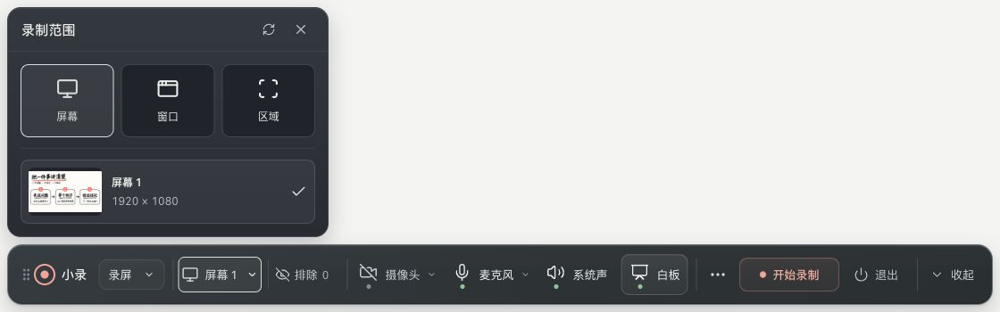
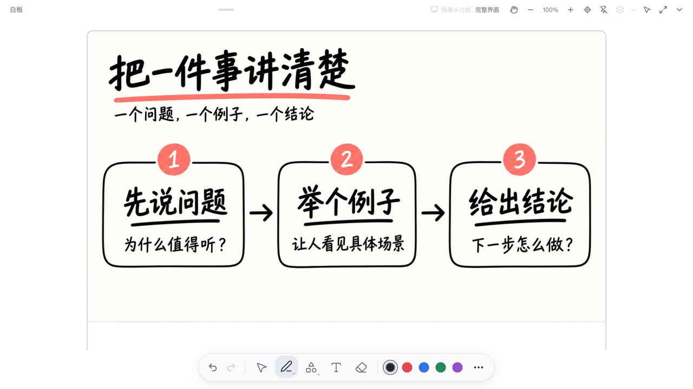
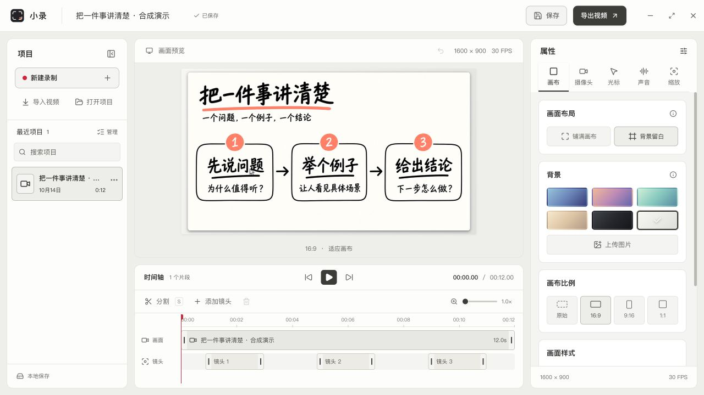

# 小录 · SmoRec


小录是一款开源桌面工具，把**录屏、摄像头、声音、白板演示和本地剪辑**放在同一条流程里。录一段软件操作、讲清一张流程图、做产品说明，录完直接剪辑和导出；也可以将画面用于直播。

[官网与下载](https://smorec.xiaomolian.com/) · [界面演示](#界面演示) · [运行源码](#运行源码) · [开发文档](DEVELOPMENT.md) · [参与贡献](CONTRIBUTING.md)

## 能做什么

| 你要做的事 | 小录提供的能力 |
| --- | --- |
| 录一段操作 | 选择整个屏幕、单个窗口或框选区域，分别控制麦克风和系统声 |
| 边操作边讲解 | 摄像头浮窗、人物画面布局、提词器与声音效果 |
| 讲清一个思路 | 白板手写、文字、图形、连线与图片；支持纯画布和完整界面两种呈现 |
| 突出重点 | 记录光标和点击，自动生成或手动调整缩放镜头 |
| 把录制变成成片 | 时间轴分割、裁剪、删除片段，调整画布比例、背景、圆角和人物布局 |
| 在直播中演示 | RTMP/RTMPS推流，或通过虚拟摄像头把合成画面交给直播伴侣 |
| 保留自己的素材 | 工程与原始媒体保存在本机，编辑视频不需要先上传到云端 |

适合软件教程、操作演示、课程讲解、产品介绍，以及需要同时展示屏幕和人物的直播。摄像头、语音模型和直播配置可以按场景选用。

## 界面演示

以下截图来自0.9.118公开源码的真实界面组件，使用合成工程与模拟设备数据；它们展示界面和操作结构，不代表真实设备录制或直播平台验收。封面与示例讲解内容由ImageGen生成，来源见[图片说明](docs/readme/README.md)。

### 1. 先选好录什么

选择屏幕、窗口或区域，在同一条操作栏里控制摄像头、麦克风、系统声和白板。



### 2. 用白板把思路展开

讲解时可以书写、放入文字与图片、连接图形；按场景选择只呈现画布，或保留完整白板界面。



### 3. 录完直接进入编辑器

在时间轴里剪掉多余片段、调整镜头，再设置画布和导出。也可以导入已有视频继续编辑。



## 开始使用

**直接使用桌面版：**前往[小录官网](https://smorec.xiaomolian.com/)下载对应平台的安装器。本仓库当前提供客户端源码，尚未发布GitHub二进制Release。

1. 选择录制范围，按需要开启摄像头、麦克风和系统声，完成操作系统要求的权限授权。
2. 开始录制，用屏幕操作、白板或人物画面完成讲解。
3. 点击“停止并编辑”，在时间轴调整片段、画布与镜头。
4. 导出视频；原始素材继续保留，之后可以重开工程再编辑。

直播时，先配置推流地址或虚拟摄像头输出，检查预览，再开始对外输出。具体平台接入、系统签名及授权条件见[开发与构建](DEVELOPMENT.md)。

## 运行源码

需要 **Node.js 22.22+、npm 10+**。使用锁文件安装依赖：

```sh
git clone https://github.com/haoqiguai-dizao/smorec-client.git
cd smorec-client
npm ci
npm run dev:web
```

`dev:web`用于阅读和开发界面；录屏、桌面导出、设备权限与虚拟摄像头需要桌面和原生组件。完整桌面开发、Mac/Windows构建与打包步骤见[DEVELOPMENT.md](DEVELOPMENT.md)。

```sh
npm run lint
npm run typecheck
npm test
npm run build
```

### 平台状态

| 平台 | 原生支持与验证范围 |
| --- | --- |
| macOS 15+ · Apple Silicon | 原生支持目标；本次源码在macOS 27 arm64完成独立构建与Mac本地包检查，macOS 15实机尚未验证 |
| Windows · x64 | 包含采集、语音、更新与虚拟摄像头源码；此公开快照尚未完成新Windows环境的原生/NSIS构建验收 |
| Intel Mac / Linux | 没有完整原生录制支持，网页界面能运行不代表桌面链路兼容 |

当前快照基于 **0.9.118**。实际检查、平台限制与未验证场景见[VERIFICATION.md](VERIFICATION.md)；已知依赖告警与安全反馈见[SECURITY.md](SECURITY.md)。

## 文档与贡献

| 文档 | 内容 |
| --- | --- |
| [开发与构建](DEVELOPMENT.md) | 环境、桌面开发、原生依赖与本地打包 |
| [代码架构](ARCHITECTURE.md) | React、Electron、共享模型和原生模块的职责 |
| [参与贡献](CONTRIBUTING.md) | 提问题、提交改动、检查与文档约定 |
| [安全反馈](SECURITY.md) | 私密漏洞报告入口与已知依赖范围 |
| [第三方声明](THIRD_PARTY_NOTICES.md) | 依赖、原生运行库、模型与对应源码要求 |
| [素材与品牌](ASSETS.md) | 图标、演示图片、第三方素材及官方身份边界 |

欢迎提交能复现的问题和小而完整的修复。涉及录制或直播时，请说明系统、版本、操作步骤与失败后的状态，并使用无隐私的最小样本。安全漏洞请使用[私密报告入口](https://github.com/haoqiguai-dizao/smorec-client/security/advisories/new)。

## 开源与发行范围

客户端自有代码、文档及本次演示资源采用 **GPL-3.0-or-later**，完整条款见[LICENSE](LICENSE)。可以按该许可使用、修改、商用和再分发；第三方独立文件保留各自许可证。

公开范围是筛选后的客户端快照。生产后端、发布凭据、原私库历史、用户工程和真人宣传素材不在此范围，详见[PUBLICATION-PLAN.md](PUBLICATION-PLAN.md)。源码文件摘要在[SOURCE-MANIFEST.json](SOURCE-MANIFEST.json)。

自编译程序默认使用无效更新地址与空信任公钥。官方发行的签名、更新服务及系统组件授权独立管理；衍生二进制分发前，请完成对应平台验收并按第三方许可提供匹配的声明与源码材料。
